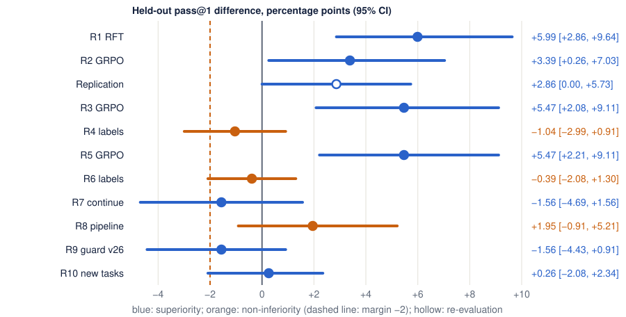
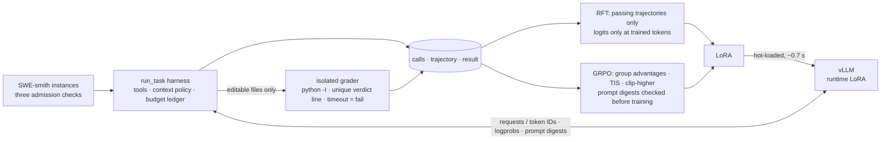

# Budget Agent

[中文](README.md) · **A verifiable environment and training loop for post-training coding agents.** Evaluation, rejection-sampling fine-tuning (RFT) and GRPO share one agent harness and one isolated grader. Every experiment ran on a single A100-40GB, and every conclusion was tested against criteria frozen before the run.

- **Training results**: RFT took a 1.5B student from 0.26% to 6.25% held-out pass@1; GRPO on top of it gained +5.47 points in two independent runs, and the best policy reached 14.58% (+7.68 over the SFT student, 95% CI [+3.78, +12.11]).
- **Reward integrity**: five grading distortions an RL policy could exploit were found and fixed; all 827 passing patches were reviewed and compared with the source before the bug was injected, and 11 executable hidden checks agree with the manual verdicts.
- **Systems**: prefix packing cut training time per turn by 36%; pipelined GRPO passed a non-inferiority test (12.6% faster on one GPU); chunked log-probabilities fit a 3B student next to vLLM on the same card.
- **Test-time selection**: with 8 samples per task, picking one only by whether the agent itself finished raises the best policy from 14.58% to 21.15% (+6.56, 95% CI [+3.40, +10.29]; a pre-registered offline analysis), and it holds in all six evaluation pools.
- **Stability**: the share of invalid actions flagged a policy collapse about 9 steps before entropy did, while the reward showed nothing; a guard now stops and rolls back automatically. Three ways of training further did not raise held-out pass@1, and the records say so.

## Results

Each row is a comparison whose decision rule was frozen before the run: 96 held-out tasks from 4 repositories never used in training, paired bootstrap over tasks (10,000 resamples), 95% confidence intervals in percentage points. Generated from the raw outputs in `docs/data/` by `scripts/results_table.py`; a test fails if this table, the Chinese one or the figure drifts from the data.

<!-- results:start -->
| Experiment | Held-out pass@1 | Delta [95% CI] | Verdict | Record |
|---|---|---|---|---|
| RFT: the 7B teacher's (7.29%) passing trajectories distilled into a 1.5B student | 0.26% → 6.25% | +5.99 [+2.86, +9.64] | improved | [Round 1](docs/EXPERIMENT_SWESMITH_RFT_ROUND1.md) |
| GRPO, 12 steps | 6.25% → 9.64% | +3.39 [+0.26, +7.03] | improved (marginal) | [Round 2](docs/EXPERIMENT_GRPO_ROUND2.md) |
| Independent re-evaluation of the same two policies | 7.03% → 9.90% | +2.86 [0.00, +5.73] | not replicated | [Replication](docs/EXPERIMENT_REPLICATION.md) |
| GRPO, 25 steps, hardened harness | 6.51% → **11.98%** | **+5.47 [+2.08, +9.11]** | improved | [Round 3](docs/EXPERIMENT_GRPO_ROUND3.md) |
| Fixed vs relabelled history (non-inferiority, margin −2) | 6.90% → 5.86% | −1.04 [−2.99, +0.91] | non-inferiority not shown; not adopted | [Round 4](docs/EXPERIMENT_LABELS_AB.md) |
| GRPO, 29 steps, prefix packing, independent rerun with another seed | 6.90% → **12.37%** | **+5.47 [+2.21, +9.11]** | improved; replicated | [Round 5](docs/EXPERIMENT_GRPO_ROUND5.md) |
| SFT student retrained on fixed labels vs the original (non-inferiority, margin −2) | 6.90% → 6.51% | −0.39 [−2.08, +1.30] | non-inferiority not shown (by 0.08); not adopted | [Round 6](docs/EXPERIMENT_LABELS_SFT.md) |
| Round 5's adapter trained 46 more GRPO steps vs round 5 | 12.37% → 10.81% | −1.56 [−4.69, +1.56] | no further gain detected; late collapse | [Round 7](docs/EXPERIMENT_GRPO_ROUND7.md) |
| Pipelined GRPO (rollouts overlap training) vs round 5's synchronous run (non-inferiority, margin −2) | 12.37% → **14.32%** | +1.95 [−0.91, +5.21] | non-inferior, now the default; GRPO time −12.6% | [Round 8](docs/EXPERIMENT_GRPO_ROUND8.md) |
| The round 7 adapter the health guard keeps (v26) vs round 5 | 12.37% → 10.81% | −1.56 [−4.43, +0.91] | no gain detected: more training on the same tasks stopped helping | [Round 9](docs/EXPERIMENT_GRPO_ROUND9.md) |
| Round 8's policy trained on 14 fresh tasks vs round 8 | 14.32% → 14.58% | +0.26 [−2.08, +2.34] | no gain detected: the new tasks were learned, held-out did not move | [Round 10](docs/EXPERIMENT_GRPO_ROUND10.md) |
<!-- results:end -->



Eight training runs (RFT, six GRPO runs, one SFT retrain), two evaluation-only experiments and one label A/B took 38.2 GPU hours (about ¥125). Rounds 11 (round 8 with another seed) and 12 (a 3B student) are frozen but did not run: the GPU instance was stopped by the platform when the account balance ran out.

## How it works



- **Environment without Docker.** One venv per repository; every run asserts the package under test is imported from the working tree; three admission checks (clean tests pass twice, the injected bug fails at least one test, results are stable). 288/288 tasks admitted, 0 of 37,237 pass-to-pass tests dropped.
- **Reward you can trust.** The grader starts with `python -I -B`, needs a unique verdict line, and counts a timeout as a failure: a policy must never be able to avoid a negative reward by hanging (an "ungraded" timeout is removed from its GRPO group and gets no gradient, which makes hanging better than failing). Passing patches are compared with the pre-bug source (`scripts/review_patches.py --original`) to measure what the tests do not cover.
- **Token-exact data path.** vLLM returns sampled token IDs and log-probabilities; the harness records them with a blake2b digest of the prompt tokens. The trainer re-renders each prompt and trains only turns whose digest matches: 27,727 training turns over six runs, all matched; trainer and sampler log-probabilities differ by about 0.002 nat.
- **Single-GPU colocated GRPO.** vLLM holds 45% of the memory and hot-loads a new LoRA each step; the trainer uses the rest. Token-level loss, clip-higher, truncated importance sampling against the sampler's log-probabilities, minibatch PPO, prefix packing (consecutive turns of an attempt trained as one sequence, gradients identical), and an optional pipeline that samples the next step while the current one trains.
- **Health monitoring.** Every step records the invalid-action share and output length; `--halt-invalid-share` stops a run after consecutive unhealthy batches and `final.json` names the last healthy policy.
- **Operations.** Experiment rounds are chained only after a clean finish, an idle GPU and a verified code-tree hash; finished rollouts are archived and packed with per-file SHA-256 checks; all drivers refuse to run on a busy GPU.

## Quick start

CPU only:

```bash
python -m pip install -e ".[dev]"
python -m pytest -q
python -m budget_agent demo --output runs/demo   # scripted repairs on three bundled fixtures, 9 runs, HTML report
```

Building the local SWE-smith tasks (CPU, needs access to Hugging Face and GitHub):

```bash
python -m pip install -e ".[swesmith]"
python scripts/select_swesmith_instances.py <SWE-smith shard dir> instances.jsonl selection.json
python scripts/build_swesmith_local.py --instances instances.jsonl --repos <mirror clones> \
  --venvs <venv dir> --output swesmith --plugin src/budget_agent/pytest_outcomes.py \
  --extras configs/swesmith-extras.json
```

Rollouts, RFT and GRPO on a GPU host:

```bash
scripts/autodl/serve_vllm.sh <model dir> teacher           # listens on 127.0.0.1:18017 only
scripts/autodl/run_pool.sh --config configs/swesmith-vllm-tokens.toml --tasks swesmith/train.jsonl \
  --samples 4 --output /opt/coding-agent/work/teacher        # agent commands run as nobody
python scripts/sft_data_from_runs.py --attempts <attempts.jsonl> --output sft.jsonl
python scripts/train_sft_lora.py --model <student> --data sft.jsonl --output out/sft --merge
python scripts/compare_pools.py --baseline <before> --candidate <after> --split eval
python scripts/grpo_harness.py --base-model <model> --tasks swesmith/train.jsonl \
  --config configs/swesmith-vllm-tokens.toml --output out/grpo --rollouts /opt/coding-agent/work/grpo \
  --pack-turns --pipeline --halt-invalid-share 0.04
```

`docs/REPRODUCE.md` has every round's exact commands, and `scripts/autodl/` holds the frozen driver of each round.

## Method

Every experiment has a protocol committed before it runs (question, setup, primary metric, decision rule, secondary metrics, budget, known limitations); results are appended below it and never edit the criteria. Corrections are appended with their evidence (for example, an early claim that RL increased weak fixes was withdrawn after a pooled test gave p = 0.26). Superiority comparisons need the interval's lower bound above 0; non-inferiority comparisons (system changes) need it above −2 points.

## Repository

- `src/budget_agent/`: the harness, grader, tasks, token accounting and the GRPO core (standard library only; torch and tokenizers are optional).
- `scripts/`: training (`grpo_harness.py`, `train_sft_lora.py`), evaluation pools, comparisons (`compare_pools.py`), analysis tools, and the GPU-host drivers in `scripts/autodl/`.
- `docs/`: experiment records (`EXPERIMENT_*.md`), the technical report (`TECH_REPORT.md`), reproduction and development guides, and raw outputs in `docs/data/`. The documents are written in Chinese.
- Engineering: 1,000+ tests (Linux and Windows, Python 3.11 and 3.13), ruff and mypy, a full-suite job with the GPU host's training stack on CPU (line plus branch coverage 90%, floor 89%), and lock files for the GPU host.

## Limitations

Four held-out repositories; synthetic bugs whose passing fixes are mostly one-line reversions; tests that cover only the main symptoms of each bug; one seed per configuration.
