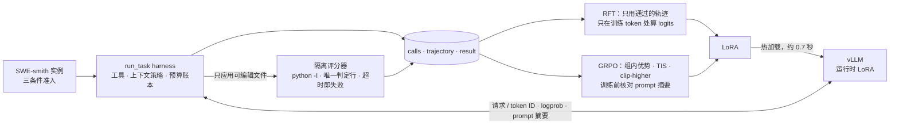

# Budget Agent

**面向 coding agent 后训练的可验证环境和训练闭环。** 评测、拒绝采样微调（RFT）和 GRPO 共用同一个 agent harness 与同一个隔离评分器。全部实验在一张 A100-40GB 上完成，每个结论都有运行前冻结的判据。

## 结果

| | 结论 | 证据 |
|---|---|---|
| **RFT** | 7B 教师的 619 条通过轨迹蒸馏到 1.5B 学生。留出的 4 个仓库共 96 题，pass@1 从 **0.26% 升到 6.25%**（教师 7.29%），95% 置信区间 [+2.86, +9.64] 个百分点。机制：`edit_file` 成功率从 10.4% 升到 49.5% | [第一轮](docs/EXPERIMENT_SWESMITH_RFT_ROUND1.md) |
| **GRPO** | 在 SFT 学生上做单卡 GRPO，12 步。两次独立评测中，pass@1 分别提高 **+3.39** 和 **+2.86** 个百分点（6.25% → 9.64%；7.03% → 9.90%）。第一次按冻结判据为"提升"，区间 [+0.26, +7.03]；复现评测的区间是 [0.00, +5.73]，按冻结规则"未复现"。合并每题 8 次采样后为 +3.13，区间 [+0.52, +6.12]。结论：增益约 3 个百分点，方向稳定，统计上处在边缘。同一策略两次评测的噪声不到 1 个百分点 | [第二轮](docs/EXPERIMENT_GRPO_ROUND2.md)、[复现](docs/EXPERIMENT_REPLICATION.md) |
| **一致性** | 训练端与采样端的 prompt 在 token 层面完全一致：3,417 个训练 turn 的摘要全部吻合。logprob 平均差 ≤ 0.0025 nat，TIS 从未截断 | [技术复盘 §4](docs/TECH_REPORT.md) |
| **系统** | 单卡 7B agent rollout 受 prefill 限制：prompt token 是生成 token 的 108 到 141 倍，8 个 worker 时 GPU 已饱和，环境开销只占 4% 到 11%。前缀打包训练（同一次尝试中前缀一致的 turn 合成一条序列）让训练编码的 token 减少 3.06 倍，loss 和梯度完全等价；进一步分析发现四分之三的断点来自"编辑后把旧事件重新标注为 stale"，改成固定标注后估计可达 5.2 倍，固定标注对通过率的影响正在做 A/B 评测 | [基准](docs/BENCH_ROLLOUT_2026-11-06.md)、[打包](docs/PREFIX_PACKING.md) |

三轮评测和训练共 6.3 GPU 小时，约 21 元。留出集上通过的 126 个补丁都逐条人工检查过，没有发现作弊。原始输出在 [`docs/data/`](docs/data/)。



## 技术要点

- **奖励可信。**
  - 发现并修复了 5 类评分失真：标准库遮蔽、伪造判定行、git index 被改写、超时被当成"未评分"、统一超时导致的长尾。
  - 原则：每一条"排除"规则，都要问策略能不能主动触发它。
  - 详见 [技术复盘 §3](docs/TECH_REPORT.md)。
- **不依赖 Docker 的环境。** 每个仓库一个 venv，每次运行都断言被测包从当前树导入，准入有三个条件。288/288 题准入，37,237 个 P2P 测试 0 丢弃。
- **token 级数据通路。**
  - 记录采样 token、behavior logprob 和 prompt 摘要；训练前比对摘要，不一致的 turn 不训练。
  - SFT 只在需要预测训练 token 的位置算 logits，16k 样本的显存从约 34 GiB 降到 11.8 GiB，数学上等价。
- **单卡共置的 GRPO。** vLLM 占 45% 显存，训练进程用其余显存。每步保存 LoRA 并热加载，服务不重启。支持 token 级聚合、clip-higher、TIS 和 minibatch PPO。
- **为训练效率设计上下文。** 同一段前缀既决定推理时的前缀缓存命中，也决定训练时能否打包。前缀打包已经实现，并在 CPU 上验证了与逐 turn 前向等价；`revision_labels = fixed` 让历史在窗口滑动之前只追加不改写。数据见 [PREFIX_PACKING.md](docs/PREFIX_PACKING.md)。
- **可复核的结论。**
  - 协议先提交再运行，按题做配对 bootstrap，另外报告剔除可疑样本后的结果。
  - 偏差和事故都写进实验记录，例如试跑里一个变量覆盖的 bug、一次以为已停止的后台任务覆盖了服务器文件。

## 快速开始

只需 CPU：

```bash
python -m pip install -e ".[dev]"
python -m pytest -q
python -m budget_agent demo --output runs/demo   # 脚本化修复，9 次运行，附 HTML 报告
```

构建 SWE-smith 本地任务（只需 CPU，需要访问 HF 和 GitHub）：

```bash
python -m pip install -e ".[swesmith]"
python scripts/select_swesmith_instances.py <SWE-smith 分片目录> instances.jsonl selection.json
python scripts/build_swesmith_local.py --instances instances.jsonl --repos <镜像克隆目录> \
  --venvs <venv 目录> --output swesmith --plugin src/budget_agent/pytest_outcomes.py \
  --extras configs/swesmith-extras.json
```

在 GPU 主机上跑 rollout、RFT 和 GRPO：

```bash
scripts/autodl/serve_vllm.sh <模型目录> teacher           # 只监听 127.0.0.1:18017
scripts/autodl/run_pool.sh --config configs/swesmith-vllm.toml --tasks swesmith/train.jsonl \
  --samples 4 --output /opt/coding-agent/work/teacher        # 以 nobody 身份运行 agent 命令
python scripts/sft_data_from_runs.py --attempts <attempts.jsonl> --output sft.jsonl
python scripts/train_sft_lora.py --model <学生模型> --data sft.jsonl --output out/sft --merge
python scripts/compare_pools.py --baseline <训练前> --candidate <训练后> --split eval
python scripts/grpo_harness.py --base-model <模型> --tasks swesmith/train.jsonl \
  --config configs/swesmith-vllm.toml --output out/grpo --rollouts /opt/coding-agent/work/grpo
```

## 模块

| 路径 | 作用 |
|---|---|
| `runner.py` | 单个任务的执行循环：模型 → 动作 → 环境 → 独立评分 |
| `context.py`、`budget.py` | 上下文策略（full / recent / mask / mask-read / summary / structured）。预算在调用前预留，调用后按实际用量对账 |
| `environment.py` | 文件工具、命令执行、Docker、隔离评分器、git 快照、任务级解释器和网络策略 |
| `models.py` | OpenAI 兼容客户端：拒绝重定向，可选记录 token ID 和 logprob |
| `pytest_outcomes.py` | 记录每个测试节点的精确结果，不依赖解析日志 |
| `learning/grpo_core.py` | 分组、优势、token 级损失、TIS（纯函数，有单元测试） |
| `scripts/` | SWE-smith 构建、rollout 池、RFT、GRPO、对比分析、基准测试 |
| `scripts/autodl/` | 共享 GPU 实例上的隔离运行脚本 |

## 文档

- **[技术复盘：从评测 harness 到 RL 环境](docs/TECH_REPORT.md)**（先读这篇）
- [复现指南](docs/REPRODUCE.md)：硬件、费用、部署和每一轮的命令
- 实验记录：
  - [第一轮 RFT](docs/EXPERIMENT_SWESMITH_RFT_ROUND1.md)
  - [GRPO 试跑](docs/EXPERIMENT_GRPO_PILOT.md)
  - [第二轮 GRPO](docs/EXPERIMENT_GRPO_ROUND2.md)
  - [复现评测](docs/EXPERIMENT_REPLICATION.md)
  - [rollout 吞吐基准](docs/BENCH_ROLLOUT_2026-11-06.md)
- [代码审查与修复（2026-11-05）](docs/CODE_REVIEW_2026-11-05.md)、[项目历史](docs/HISTORY.md)、[SWE-bench 协议](docs/EXPERIMENT_PROTOCOL.md)、[训练说明](docs/TRAINING.md)
- 测试：990+ 个，CI 覆盖 Linux 和 Windows、Python 3.11 和 3.13
