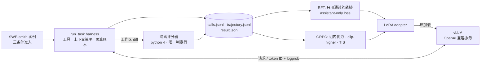

# Budget Agent

**面向 coding agent 后训练的可验证执行环境和训练闭环。** 评测和训练共用同一个 agent harness（工具、上下文策略、预算账本）。仓库包括：不依赖 Docker 的 SWE-smith 任务构建与准入、在独立进程中运行的评分器、token 级 rollout 记录，以及拒绝采样微调（RFT）和 GRPO 的工具链。



## 已核验的数字

| 方面 | 结果 | 证据 |
|---|---|---|
| 奖励可信度 | 修掉 3 类评分失真：<br/>① 仓库文件遮蔽评分器的标准库，bug 没修也判通过；<br/>② 候选代码抢先打印伪造的判定行；<br/>③ 导出补丁时改写了 git index，导致状态指纹失真，嵌套仓库时还会崩溃。<br/>进程内伪造的残留风险保留为 strict xfail，明确标出 | [代码审查](docs/CODE_REVIEW_2026-11-05.md)、`tests/test_grader_isolation.py`、`tests/test_git_snapshot.py` |
| 环境规模与保真度 | 288/288 个 SWE-smith 实例不依赖 Docker 准入，覆盖 12 个仓库。37,237 个 PASS_TO_PASS 测试 0 个被丢弃。单次测试 P50 0.47 秒，准入吞吐约每分钟 195 题。此为本地预检，用 Python 3.13 | [预检记录](docs/EXPERIMENT_SWESMITH_RFT_ROUND1.md#追加本地准入预检2026-11-06运行前) |
| 防作弊 | 评分只应用允许编辑的源文件，新增文件和 conftest 不进入评分树。SWE-smith 任务上 agent 命令断网，挡住"下载上游原文件"这种作弊。被测包的导入来源每次断言 | `tests/test_task_exec_env.py` |
| 性能 | tiktoken 计数时，上下文构造快约 14×（recent）和 22×（structured），输出逐字节相同。容器内指纹计算在 6 条真实轨迹上从 132 次降到 12 次 | `scripts/bench_context_build.py` |
| 工程 | 942 个测试通过。CI 覆盖 Linux 和 Windows，Python 3.11 和 3.13，另有 mini-SWE-agent 和 OpenJudge 的契约测试 | `.github/workflows/tests.yml` |
| 训练闭环 | 第一轮 RFT 的协议和判据已冻结（教师 7B → 学生 1.5B，以留出仓库的 pass@1 为主指标，配对 bootstrap），结果等 GPU 运行后追加 | [实验协议](docs/EXPERIMENT_SWESMITH_RFT_ROUND1.md) |

## 快速开始

只需 CPU：

```bash
python -m pip install -e ".[dev]"
python -m pytest -q
python -m budget_agent demo --output runs/demo   # 脚本化修复，9 次运行，附 HTML 报告
```

构建 SWE-smith 本地任务（只需 CPU，需要访问 HF 和 GitHub）：

```bash
python -m pip install -e ".[swesmith]"
python scripts/select_swesmith_instances.py <SWE-smith 分片目录> instances.jsonl selection.json
python scripts/build_swesmith_local.py --instances instances.jsonl --repos <镜像克隆目录> \
  --venvs <venv 目录> --output swesmith --plugin src/budget_agent/pytest_outcomes.py \
  --extras configs/swesmith-extras.json
```

在 GPU 主机上跑 rollout、RFT 和 GRPO：

```bash
scripts/autodl/serve_vllm.sh <模型目录> teacher           # 只监听 127.0.0.1:18017
scripts/autodl/run_pool.sh --config configs/swesmith-vllm.toml --tasks swesmith/train.jsonl \
  --samples 4 --output /opt/coding-agent/work/teacher        # 以 nobody 身份运行 agent 命令
python scripts/sft_data_from_runs.py --attempts <attempts.jsonl> --output sft.jsonl
python scripts/train_sft_lora.py --model <学生模型> --data sft.jsonl --output out/sft --merge
python scripts/compare_pools.py --baseline <训练前> --candidate <训练后> --split eval
python scripts/grpo_harness.py --base-model <模型> --tasks swesmith/train.jsonl \
  --config configs/swesmith-vllm.toml --output out/grpo --rollouts /opt/coding-agent/work/grpo
```

## 模块

| 路径 | 作用 |
|---|---|
| `runner.py` | 单个任务的执行循环：模型 → 动作 → 环境 → 独立评分 |
| `context.py`、`budget.py` | 上下文策略（full / recent / mask / mask-read / summary / structured）。预算在调用前预留，调用后按实际用量对账 |
| `environment.py` | 文件工具、命令执行、Docker、隔离评分器、git 快照、任务级解释器和网络策略 |
| `models.py` | OpenAI 兼容客户端：拒绝重定向，可选记录 token ID 和 logprob |
| `pytest_outcomes.py` | 记录每个测试节点的精确结果，不依赖解析日志 |
| `learning/grpo_core.py` | 分组、优势、token 级损失、TIS（纯函数，有单元测试） |
| `scripts/` | SWE-smith 构建、rollout 池、RFT、GRPO、对比分析、基准测试 |
| `scripts/autodl/` | 共享 GPU 实例上的隔离运行脚本 |

## 设计要点

- **评分不信任候选代码。** 评分在单独的进程里进行。评分树从原始代码出发，只叠加允许编辑的改动。被测包必须从这棵树导入，每次都断言。同一个进程内仍无法防止主动伪造，这一点已写明，并列出了缓解办法。
- **评测和训练共用同一条路径。** RL 的 rollout 就是一次普通的 `run_task`。采样时记录下的 token ID 和 behavior logprob 直接进入训练，没有 re-tokenize 漂移。
- **共享机器上的隔离。** 模型生成的命令以 `nobody` 身份运行。vLLM 只监听本机。脚本只停止自己启动的进程。
- **结论有判据。** 协议先冻结，置信区间按任务配对计算。没评上分的运行单独计数，不当作失败。

## 文档

- [代码审查与修复（2026-11-05）](docs/CODE_REVIEW_2026-11-05.md)
- [第一轮 RFT 实验协议](docs/EXPERIMENT_SWESMITH_RFT_ROUND1.md)
- [项目历史记录（v1 至 2026-11-03 的逐轮验证）](docs/HISTORY.md)
- [实验协议（SWE-bench）](docs/EXPERIMENT_PROTOCOL.md)、[训练说明](docs/TRAINING.md)
