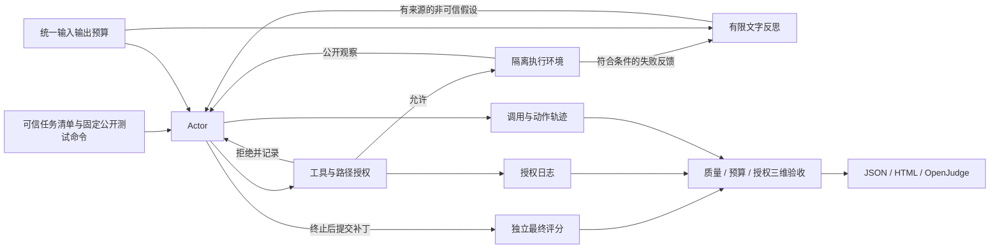

# 从研究原型到可验收的 Coding Agent

日期：2026-10-27。本轮交付的是企业工程候选版本：受预算约束的反思、执行授权、独立多维验收和真实 OpenJudge 适配。它还不是经过企业真实仓库、负载与红队验收的生产服务。

## 上游研究如何落到实现

| 来源 | 实际采用 | 明确没有做的事情 |
|---|---|---|
| [Reflexion 源码研读](UPSTREAM_REFLEXION_REVIEW.md) | 工具失败→文字诊断→有来源的记忆→下一次决策；所有调用共用预算 | 没有参数训练、跨任务经验库、隐藏测试反馈循环，也没有沿用上游隐式重试 |
| [OpenJudge 源码研读与真实适配](UPSTREAM_EVALUATION_REVIEW.md) | 实际 BaseGrader / GraderScore / GraderError / GradingRunner；独立质量、预算、授权维度 | 不用模型主观打分替代独立测试，不用加权平均抵消失败或缺失 |
| [Claw-Eval 源码研读](UPSTREAM_EVALUATION_REVIEW.md) | 准备、执行、最终评分分阶段；工具授权、动作轨迹、环境结果分别留证 | 没有运行其300题，也不把它的通用 Agent 分数当作 SWE 代码修复成绩 |
| [腾讯 AIG 源码研读](UPSTREAM_AIG_REVIEW.md) | 从真实副作用定义权限与回归用例，明确扫描失败/证据缺失 | 没有运行 AIG 扫描平台，没有把“没发现漏洞”当成安全证明 |

OpenJudge 固定 `c2fdc38314cd971b03d4d9333cd2c9f24d85c27f`；Reflexion 固定 `218cf0ef1df84b05ce379dd4a8e47f17766733a0`；Claw-Eval 固定 `5680b8b11ff2ee5dd2b07b89086a29a5c5c984d7`；AIG 固定 `33768c58942dbef693dae5e929d633daa0568b34`。各文档记录了提交日期、许可证、实际阅读的函数和限制。Claw-Eval 主要作者来自北大/港大，阿里 EvalScope 有集成；不将二者混为同一项目。

本项目没有把四个仓库复制进核心依赖。OpenJudge 是真正的可选协议集成；其余是按源码证据重新实现适合本项目的机制。上游的宿主 exec、未知用量重试、错误评分归零、扫描未完成却按无漏洞通过，都不进入本项目的默认路径。

## 一次修复的实际数据流



私有 verifier 只在终局执行一次；反思函数只有 actor 已见消息和刚完成的公开工具事件，没有读取隐藏评分的入口。公开测试通过仍可能没有解决 issue，离线演示包含这一负例。

## 配置与可复现入口

默认 `reflection_policy=off`、`execution_policy=sandbox`，保留既有参考实验条件。候选配置在 [guarded-reflection.toml](../configs/guarded-reflection.toml)：`reflection_policy=failure`、最多一次反思、512输出token、`execution_policy=restricted`。真实模型必须使用 Docker；脚本化 CPU 软件测试可以使用临时 Local fixture。

严格模式下，模型只能通过 `public_test` 执行可信任务清单的 `test_command`，不能自己传入命令或参数。公开测试命令已纳入任务指纹。没有配置命令的任务明确拒绝该工具；例如既有 SWE pilot 清单尚未提供公开测试命令，不能在未核对仓库文档时自动填入隐藏测试或猜测测试路径。

以下命令使用已有轻量 Python 环境。第一个是固定动作的离线演示，完全不运行真实模型：

```powershell
.venv\Scripts\python.exe scripts/demo_governance.py --output runs/my-contract-demo
.venv\Scripts\python.exe -m budget_agent audit --input runs/my-contract-demo --output runs/my-contract-audit.json
```

演示含一条独立通过和一条独立失败，因此整批 audit 的预期退出码是 **1**。输出0只表示所选记录的三个合同全部通过，不表示模型通过生产验收。输出文件已存在则拒绝覆盖。原始实验轨迹不被审计命令重写。

在配置了固定 OpenJudge 源码和合同依赖的 CPU 环境中，可直接使用同一批证据：

```text
python -m budget_agent audit --engine openjudge --input runs/my-contract-demo --output runs/my-openjudge-audit.json
```

专用合同环境没有安装本项目包时，须把本项目`src`和固定上游源码目录同时加入`PYTHONPATH`。例如当前Windows环境：

```powershell
$env:PYTHONPATH = 'C:/找工作/budget-agent/src;C:/找工作/.budget-agent-research/openjudge'
& 'C:/找工作/.budget-agent-research/openjudge-contract-venv/Scripts/python.exe' -m budget_agent audit --engine openjudge --input runs/my-contract-demo --output runs/my-openjudge-audit.json
```

`requirements-openjudge-contract.lock.txt` 固定该最小合同环境的直接与传递依赖；完整 OpenJudge 的模型、生成器和其他功能不属于这份环境。CI 的独立 job checkout 精确上游 SHA，并运行真实官方异步评分器。核心运行与内置审计不依赖 OpenJudge。若显式选择的上游评分器异常、缺结果或给出 GraderError，命令返回1，不静默退回内置成功。

真实云端候选运行的命令形式如下，但本轮没有执行：

```text
python -m budget_agent run --config configs/guarded-reflection.toml --tasks tasks/reviewed-dev.jsonl --model <固定模型版本> --base-url <已核实的服务地址> --output runs/guarded-dev
```

`tasks/reviewed-dev.jsonl` 是待准备的可信任务清单占位路径，不是当前已存在的数据集。模型凭证只使用环境变量；在确认主机、镜像、任务和独立费用方案前不能把该示例当作可立即执行的授权。

## 反思的预算与信息边界

- 触发范围是失败的公开测试、一般命令、编辑锚点或动作协议反馈；工具能力与文件权限拒绝都不触发反思。
- `call(..., purpose="reflection")` 与 actor、summary 共用 Budget。后续反思记忆再次进入输入时也计费；没有免费重试。
- 次数和输出额度显式封顶；最后一步不反思，过大反思提示留下跳过记录。用量未知立即停止；实际超额不能被当作可忽略的反思失败。
- 记忆保存来源 event、revision 和 stale 标记，只以 user 数据形式进入后续请求。反思里的命令或工具JSON不会被自动执行。
- 默认关闭时不增加调用。`paired --factor reflection_policy` 可固定其他配置比较 off/failure，不能把同时改变模型、工具权限或预算的实验归因于反思。

当前实现是单次修复内的 Reflexion-inspired 变体，不是论文完整复现，更不是 Agentic RL 参数训练。生成式反思也可能误判、浪费预算或被不可信观察诱导；上述数据流测试不证明模型具备抗提示注入能力。

## 多维验收与审计证据

| 维度 | 通过依据 | 缺失或失败如何处理 |
|---|---|---|
| quality | 独立最终 verifier 的可用结果 | 未评分、矛盾、空测试为unknown；有效未修复为fail |
| budget | 完整请求账本对账一致，未超过固定token上限 | 未知/未对账为unknown，已知超额为fail；不冒充供应商账单审计 |
| safety | restricted策略、完整授权记录及合法计数，没有记录到执行违规 | 旧记录、sandbox或缺失为unknown；明确违规为fail |

任何fail阻止通过；没有fail但有unknown也不能通过。成功阻拦记入 `blocked_actions`，不会因为阻拦发生而把正确运行时控制当成执行违规。返回的scope是 `single_run_contract`，safety范围是 `direct_tool_authorization`。

`calls.jsonl` 保留actor/summary/reflection及真实用量；`trajectory.jsonl` 保留原动作与观察；`reflections.jsonl` 保留生成、跳过及来源；`security.jsonl` 保留工具判决；`patch.diff`与最终evaluation作为环境结果。审计读取result中的摘要，当前没有防篡改签名或独立日志存储服务，不能宣称不可抵赖的企业审计认证。

## 验收事实与发现的失败

真实临时 Python fixture 覆盖了公开失败→反思→修改→独立评分、记忆输入计费、过期revision、反思未知用量/超额、权限拒绝和公开测试假阳性。OpenJudge直接导入精确上游源码并执行真实类型和异步runner；模型和Docker边界分别用固定模型替身与进程合同验证，不包装为真实模型或本轮云Docker成功。

首次完整回归有16个失败，原因是旧Docker文件工具测试绕过构造器且没有提供新入口必需的config。修复了测试替身初始化及返回码，保留原始JUnit；没有给生产代码加入“缺配置就默认放行”的回退。独立审查另发现显式OpenJudge执行错误可能仍返回成功，已增加真实上游GraderError故障注入验证。

最终计数、源码指纹、文件哈希与上游合同回执见 [cpu-validation.json](../runs/enterprise-contract-v1/cpu-validation.json)。原始研究回执、首次完整回归与最终结果分别保留。软件测试数量不作为企业能力或模型收益指标。

本轮完整CPU套件为 **656 passed / 11 skipped**；专用真实OpenJudge集成环境为 **42 passed / 0 skipped**。主环境的11项跳过记录为2个Torch模块、6个固定mini-SWE集成和3个可选OpenJudge跳过记录，OpenJudge实际用例已在专用环境执行。最终[HTML演示](../runs/enterprise-contract-v1/demo-final/report/report.html)与[OpenJudge审计](../runs/enterprise-contract-v1/openjudge-demo-audit.json)均保留一条通过、一条失败，批量审计退出1为预期行为。

## 成为可部署企业项目还差什么

1. **真实修复参考。** 先完成已批准、尚未启动的两阶段参考试跑，取得非空补丁、独立评分和真实账本；该次授权的默认配置仍关闭新反思，不扩大原预算。
2. **固定任务的收益实验。** 在多个真实仓库开发任务上冻结模型、环境、任务清单和预算，比较原actor、显式重呈失败证据、生成反思三种条件。当前只有off/failure两种运行策略；第三种证据重呈对照尚未实现。所有失败和未评分都保留，报告独立修复率、反思输入/输出开销和退化案例。最终测试集不能继续用于策略选择。
3. **真实安全与可靠性实验。** 对干净/含注入仓库成对测试，测攻击成功率、误拒率、修复率、恢复能力和未完成场景。AIG接入需要隔离的目标服务与单独模型预算；没有完成的扫描不能算通过。公开测试内部仍可执行源码并产生容器内副作用；独立grader也未被证明能抵抗恶意代码干扰同进程测试框架。
4. **部署控制。** 多租户身份与权限、队列取消/恢复、独立持久存储、日志访问控制、资源与网络隔离的真实验证、密钥生命周期、负载/超时与运维恢复都需要专门实现和验收。当前CLI没有这些服务能力；没有为展示而加一个未经隔离的公网Web壳。

项目求职主线可以表述为“固定预算 Coding Agent 的反馈优化、可信评测与执行治理”。只有真实实验完成后，才能增加成功率、成本节省或安全防御效果等量化简历结论。
