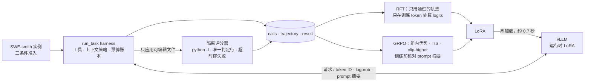

# 从评测 harness 到 RL 环境：coding agent 后训练闭环

本文写于 2026-11-11，已更新到第四轮的结果。所有数字都对应仓库里的代码、测试、实验记录或 [`docs/data/`](data/) 中的原始输出。

## 结论先行

- **RFT（第一轮）。** 用 7B 教师的通过轨迹对 1.5B 学生做 LoRA SFT。在 4 个没见过的仓库上，pass@1 从 **0.26% 升到 6.25%**；教师是 7.29%。配对 bootstrap 的 95% 置信区间为 [+2.86, +9.64] 个百分点。
- **GRPO（第二轮、复现、第三轮）。** 在 SFT 学生上做单卡 GRPO。第二轮 12 步，两次独立评测中 pass@1 分别提高 +3.39 和 +2.86 个百分点，统计上处在边缘。第三轮在加固后的 harness 上训练 25 步，pass@1 从 6.51% 升到 **11.98%**，差值 **+5.47**，95% 置信区间 [+2.08, +9.11]，按冻结判据为"提升"。
- **奖励的覆盖范围。** 把每个通过的补丁与注入 bug 之前的源码对照：各策略的通过补丁中约 10% 到 15% 通过了测试却没有恢复原有行为，集中在三道测试漏掉了部分 bug 的题上。把这类补丁算作失败，第三轮的增益是 +2.6 到 +3.4 个百分点，区间仍在 0 以上。GRPO 与 SFT 的比例差异不显著。verifier 的覆盖范围就是奖励的覆盖范围。
- **固定标注（第四轮）。** 让历史只追加不改写后，打包训练的节省从 2.86 倍提高到 4.48 倍（事先估计 4.43 倍），前缀缓存命中率提高 5.8 个百分点；但通过率低了 1.04 个百分点，区间 [−2.99, +0.91]，非劣性没有得到证明，配置保持重新标注。
- **数据通路。** 训练端和采样端看到的 prompt 在 token 层面完全一致：两轮共 8,311 个训练 turn 的 prompt 摘要全部吻合。logprob 平均只差约 0.002 nat，TIS 权重从来没有被截断。
- **系统。** 单卡 7B 做 agent rollout 时，瓶颈在长上下文的 prefill：prompt token 是生成 token 的 108 到 141 倍。环境开销只占 4% 到 11%，增加并发也不能提高吞吐。

## 1. 问题

coding agent 的后训练依赖三样东西：可信的奖励、与评测一致的 rollout、能算清楚的成本。本项目在一张 A100-40GB 上把三者做齐，并用带冻结判据的实验检验：每个实验都在运行前提交协议，运行后只追加结果。

## 2. 系统

- **一条代码路径。** SFT 数据、GRPO rollout 和留出集评测都由同一个 `run_task` 产生，工具、上下文策略（`recent`）和 30 步上限都相同。
- **不依赖 Docker 的环境。**
  - 12 个仓库各有一个 venv，被测包每次都断言是从当前树导入的。
  - 准入有三个条件：干净代码连跑两次都通过；bug 至少让一个 F2P 测试失败；两次结果一致。
  - 288/288 题准入，37,237 个 P2P 测试 0 丢弃。
- **共享 GPU 上的隔离。**
  - 模型生成的命令都以 `nobody` 用户执行，解释器单独装在 `/opt` 下。
  - vLLM 只监听本机。
  - 只停自己启动的进程；GPU 上有任务时不叠加新任务。

## 3. 奖励可信度

原则是：每一条"排除"或"不计分"的规则，都要问一句策略能不能主动触发它。

| 失真 | 后果 | 处理 |
|---|---|---|
| 仓库里的 `unittest.py` 遮蔽了评分器导入的标准库 | bug 没修也判通过 | `python -I -B` 启动评分器，先导入自己的模块，再加入候选代码目录 |
| 候选代码抢先打印伪造的判定行 | 伪造通过 | 判定行必须唯一；进程内的残留风险保留为 strict xfail |
| 导出补丁时改写了 git index | 状态指纹失真 | 在临时 `GIT_INDEX_FILE` 上执行 `write-tree`；用 `copy2` 保留 racy-git 判断 |
| 补丁把测试卡死，verifier 超时被记为"未评分" | GRPO 会把这次尝试移出组，"卡死"反而比"失败"划算 | 超时记为失败 |
| 统一 300 秒的命令和 verifier 上限 | 一次卡死就让整批同步 rollout 多等 8 到 13 分钟（第二轮第 7、10、11 步） | 按准入时测得的耗时设定：max(30 秒, 10 × 最慢的一次) |

另外三项防护：
- 只应用可编辑的源文件，新增的 conftest 进不了评分树；
- agent 命令断网；
- 补丁扫描器标记篡改模式，被标记的轨迹不进入 SFT 数据。

各轮留出集上通过的补丁都逐条人工检查过，都是单文件的源码修复，没有修改测试，也没有碰评分通道。

**verifier 覆盖不到的地方。** 第三轮之后，又把每个通过的补丁应用到带 bug 的文件上，再与注入 bug 之前的源码比较（`scripts/review_patches.py --original`），剩余差异逐条判断：

| 评测池 | 通过 | 与原始源码一致 | 行为等价 | 没有恢复原有行为（轻微 / 严重） |
|---|---|---|---|---|
| SFT 学生（第一轮、复现、第三轮、第四轮 `relabel`） | 129 | 58 | 42 | 16 / 13 |
| GRPO 策略（第二轮、复现、第三轮） | 121 | 52 | 32 | 19 / 18 |

- "严重"指注入的 bug 还有一部分在，或者在普通输入上出错。例如 `utcoffset` 保留了"12 月 31 日返回 None"，只是加了 None 判断；`FrozenDict.clear()` 静默成功而不是报错；批量更新时仍会删掉 id 为偶数位数的文档。
- 这些补丁都通过了 F2P 和 P2P 测试。测试只覆盖注入 bug 的主要症状，没有覆盖原函数的全部行为。严重的补丁主要集中在三道题上（`xewv2osl`、`u30gcrhh`、`ckf9bzo4`），教师、SFT 学生和 GRPO 策略都会产生。
- 严重的比例在 GRPO 一侧是 14.9%，SFT 一侧是 10.1%，Fisher 精确检验 p = 0.26，差异不显著。同一个 SFT 学生两次评测之间就有 0/25 和 8/53 的差别。第三轮记录里"RL 提高了这类补丁的比例"一句已经撤回。
- 这不是评分器的 bug，而是奖励本身的边界。合成 bug 的任务可以拿原始源码做这种复核；真实任务没有原始源码，只能靠更完整的测试。

## 4. token 级数据通路

- **completion。** vLLM 返回每个采样 token 的 ID 和 logprob。客户端要求它们覆盖全部计费的 completion token，否则直接报错。
- **prompt。** 采样时只保存 vLLM 实际 prompt token 的 16 字节摘要（存全文的话，几步就是 GB 级）。训练端重新渲染后比对摘要，不一致的 turn 不训练；如果一整步都对不上，就报错退出。
- **SFT 显存。**
  - 被训练的 token 只占 0.97%。原来的 loss 在 16k token 的样本上峰值约 34 GiB，40GB 的卡有显存不足风险。
  - 改成只在预测训练 token 的位置算 logits：loss 和梯度与原写法的差在 1e-6 以内，实测显存 11.8 GiB。
- **上下文预算。**
  - 字节预算限不住真实 token 数：第一轮里 80,000 字节在高密度代码上达到 32,188 个 token，有 2 次请求超出了 32k 窗口。
  - 现在改用被服务模型自己的 `tokenizer.json` 计数。在 2,025 次真实请求上，估计值与实际值之比在 1.002 到 1.089 之间，从来没有低估。

## 5. 结果

| 留出集（4 个仓库，96 题 × 4 次） | 学生基线 | SFT 学生 | GRPO 策略 | 教师 7B |
|---|---|---|---|---|
| pass@1 | 0.26% | 6.25%（复现 7.03%） | 9.64%（复现 9.90%） | 7.29%（每题 2 次） |
| 解出题数 | 1 | 14 | 16 | 11 |
| `edit_file` 成功率 | 10.4% | 49.5% | 51.6% | 51.4% |
| finished / stuck / max_steps | 47 / 206 / 131 | 42 / 215 / 127 | 92 / 134 / 158 | 16 / 127 / 47 |

- **RFT**：教师在训练集上 768 次采样中通过 55 次（33 题），得到 619 条样本。训练 155 步，耗时 17 分钟。提升来自"把编辑做对"：`edit_file` 成功率与教师持平，而主动结束的次数没有变。
- **GRPO**：
  - 每步 8 题 × 8 次；每次尝试抽 6 个 turn；每批 4 次 PPO 更新；学习率 2e-5。到 120 分钟上限时完成 12 步。
  - 主动结束的次数从 42 增加到 92，stuck 从 215 降到 134。复现评测中同样是 92 对 45、147 对 205。
- **复现评测**：
  - 同一个策略两次评测之差不到 1 个百分点（SFT +0.78，GRPO +0.26），说明评测噪声比观测到的增益小。
  - 但每次只有每题 4 次采样，单次评测的检验力不足以确认约 3 个百分点的增益。
- **第三轮**（加固后的 harness：按题测试时限、命令内存上限、按真实 token 的上下文预算）：

  | 留出集（96 题 × 4 次） | SFT 学生 | GRPO 策略（25 步） |
  |---|---|---|
  | pass@1 | 6.51% | 11.98% |
  | pass@4 | 13.54% | 18.75% |
  | 解出题数 | 13 | 18 |
  | finished / stuck / max_steps | 52 / 194 / 138 | 156 / 136 / 92 |
  | 主动结束时确实修好的比例 | 48% | 29% |

  - 差值 +5.47 个百分点，区间 [+2.08, +9.11]，15 题变好、4 题变差。加固后的 harness 对 SFT 学生本身没有可检测的影响（+0.26，区间 [−1.56, +2.08]）。
  - 每步 8 题 × 8 次，每次尝试抽 4 个 turn，学习率 2e-5，到 180 分钟上限时完成 25 步。
  - 策略更常主动结束，但没修好就结束的次数也从 27 增加到 110。它还改用 `run` 直接跑带覆盖率的完整测试（340 次尝试，SFT 是 106 次），每次尝试的输入 token 多了 37%。
  - 按"恢复原有行为"计（见 §3），增益为 +2.6 到 +3.4 个百分点，区间仍在 0 以上。
- **第四轮**（固定标注的非劣性 A/B，SFT 学生，每题 8 次）：重新标注 6.90%，固定标注 5.86%，差值 −1.04，区间 [−2.99, +0.91]。下界低于 −2.0 的界限，按冻结规则保持重新标注。这个策略是在重新标注的历史上训练的，测到的是分布偏移，不是固定标注本身的影响。
- **成本**：第一轮 2.79 GPU 小时，第二轮 2.62，复现评测 0.92，第三轮 4.27，第四轮 2.09，合计 12.7 GPU 小时，约 42 元。

## 6. 系统测量

- **rollout 基准**（7B，单卡，64 题）：从 8 个到 64 个 worker，吞吐都是每小时 1,100 到 1,200 次，8 个 worker 时 GPU 已经饱和（97%）。prompt token 是生成 token 的 108 到 141 倍，前缀缓存命中约 0.88。
- **GRPO 的训练成本**（1.5B）：每个 turn 都要重新编码完整的 prompt，所以 GRPO 的训练很贵。试跑中训练全部 turn 时，训练时间是 rollout 的 6.6 倍；第二轮改为每次尝试抽样 6 个 turn 后，典型步骤中仍是 1.5 到 4 倍；第三轮每次尝试抽 4 个，训练仍占每步时间的 59%。
- **长尾**：按题测试时限去掉了 rollout 的长尾，每步 rollout 用时的 p90 从 631 秒降到 235 秒，最长一步从 940 秒降到 404 秒。每步平均从约 10.2 分钟降到 7.4 分钟。
- 结论：要加速，应该缩短上下文、提高前缀复用、改成异步 rollout，或者把整条轨迹打包训练，而不是增加并发。
- **前缀打包**（`docs/PREFIX_PACKING.md`）：
  - 同一次尝试中，prompt 以"上一个 turn 的 prompt + 采样回复"开头的 turn 会合成一条序列，只做一次前向，用 `logits_to_keep` 传入位置索引，只在回复位置算 logits。
  - 在第三轮前 4 步的 4,619 个 turn 上，训练编码的 token 减少 3.06 倍，训练的 token 完全相同。在小模型上，logprob 和梯度与逐 turn 前向的差在 1e-5 以内。
- **断点分析**：
  - 链断开的 695 次中，只有 23 次是回复被重新分词；507 次只是"编辑后把旧事件重新标注为 stale"导致整段历史被重新渲染。
  - 改为在记录时固定标注（`revision_labels = fixed`）后，第四轮的评测池上实测节省 4.48 倍（重新标注为 2.86 倍；在重新标注的池上事先估计为 4.43 倍），历史断点全部来自窗口滑动。前缀缓存命中率从 73.7% 提高到 79.5%，每次尝试的模型用时从 17 秒降到 12 秒。
  - 但通过率的非劣性没有得到证明（`docs/EXPERIMENT_LABELS_AB.md`），所以训练仍用重新标注，打包节省按 2.86 倍左右计。

## 7. 方法

- **冻结判据。** harness 的 A/B 也事先定好采用规则。v5 把编辑成功率从约 30% 提高到 54%，但 pass@1 下降了，按规则被否决。
- **偏差和事故如实记录。**
  - 训练脚本在训练阶段开始前替换过一次，两种写法数学上等价；
  - 一个以为已停止的后台任务覆盖过服务器文件；
  - 试跑因一个变量覆盖的 bug 崩溃。
  
  每一件都附有哈希和时间线。
- **配对比较。** 结论都来自按题配对的 bootstrap，并另外报告剔除可疑样本后的结果。

## 8. 局限与下一步

- **局限**：
  - 只有 1 个种子；
  - 4 个留出仓库；
  - bug 是合成的，通过的补丁多是单行还原；
  - 测试只覆盖注入 bug 的主要症状，GRPO 的增益里有 2 到 3 个百分点来自没有恢复原有行为的补丁。
- **下一步**：
  1. 第五轮：用前缀打包、换一个种子独立地再训练一次 GRPO，每题 8 次评测，看第三轮的提升能否重复（`docs/EXPERIMENT_GRPO_ROUND5.md`，已冻结，正在运行，按第四轮的规则使用重新标注）。对照原始源码的复核和每步训练成本是预先登记的次要指标。
  2. 更公平地检验固定标注：把第一轮的教师轨迹按固定标注重新渲染（先在原模式下逐条复现记录的请求，658 条全部一致），重训 SFT 学生，再做非劣性比较（`docs/EXPERIMENT_LABELS_SFT.md`，已冻结）。
  3. 给测试漏掉部分 bug 的题补充针对被改函数的测试，看"没有恢复原有行为"的补丁是否减少。
  4. 在 SWE-bench Verified 的子集上做外部对照。
